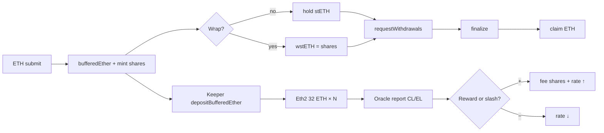

# Design decisions, logic, and gas — Module 18

**Language:** English · [Español](./decisiones-tecnicas-y-logica-ES.md)

A guide to understand **what was built**, **why** it was designed this way, **how** the protocol flows, and **where gas can be saved** later.

**Status:** v1 closed · `forge test` → 90 PASS · Sync: 2026-09-15  
**Related:** [GAS-EN.md](./GAS-EN.md) · [flujograma-EN.md](./flujograma-EN.md) · [diagrama-de-flujo-EN.md](./diagrama-de-flujo-EN.md) · [SWC-AUDIT-EN.md](./SWC-AUDIT-EN.md)

---

## 1. The idea in one sentence

You deposit ETH → you receive **stETH** (a balance that rebases on rewards/slashing) → optionally you wrap it into **wstETH** (fixed balance, growing value) → an **oracle** updates the pooled ether → unstaking is **asynchronous** through a queue (request → finalize → claim) because ETH in validators is not instantly liquid.

---

## 2. Design decisions (why this way)

### 2.1 Unified pool = `StETH` (no separate `LiquidStakingPool`)

| Decision | Discarded alternative | Reason |
|----------|----------------------|--------|
| Accounting + token in a single contract | Separate pool + token | Less wiring, fewer external calls in submit/report; simplified Lido style for a lab |
| `pooledEther = bufferedEther + clBalance` | Contract balance only | ETH on the beacon chain is not in the contract; the oracle reports CL |
| Internal shares + `balanceOf` = shares × rate | Literal “mint/burn ETH” ERC-20 | Rebase without transferring to every holder |

**Implication:** `ILiquidStakingPool` only exposes `handleOracleReport`; everything else lives in `IStETH` + pool functions in the same `StETH.sol`.

### 2.2 Dual-token: rebasing vs value-accruing

| Token | What the user holds | What changes with rewards |
|-------|---------------------|---------------------------|
| **stETH** | Shares; `balanceOf` = underlying ETH | The **balance** goes up/down (rate changes) |
| **wstETH** | 1 wstETH = **1 share** | The ERC-20 balance does **not** change; `stEthPerToken()` grows |

**Decision:** wrapper = shares (not “wstETH amount = stETH amount”). This makes wrap/unwrap bijective with `getSharesByPooledEth` / `getPooledEthByShares`.

**Why wstETH exists:** many DeFi protocols do not handle rebasing tokens well (approvals, oracles, accounting).

### 2.3 WAD / RAY precision + OZ `mulDiv`

- Shares ↔ ETH conversions: floor division via `ShareMath` → OpenZeppelin `Math.mulDiv` (512-bit intermediate product).
- `shareRateRay = pooled * 1e27 / shares` for a RAY rate.
- Empty bootstrap: **1 wei ETH ↔ 1 share** (no dead shares / offset in v1).

**Tradeoff:** flooring leaves dust; documented as an informational SWC risk, not a soft-lock (covered by fuzzing).

### 2.4 Oracle: on-chain membership (no EIP-712 in v1)

```
Committee member → AccountingOracle.submitReport(cl, el)
                 → checks members[msg.sender] + reportInterval
                 → StETH.handleOracleReport (only if msg.sender == oracle)
```

| Decision | Reason |
|----------|--------|
| Auth via `mapping members` | Simple, testable, satisfies `UnauthorizedOracle()` |
| No quorum / aggregated signatures | Out of v1 scope (lab) |
| EL rewards must already be in the contract | Prevents “inventing” buffer ETH without real balance → `InvalidReport` |
| Fee only on **positive** rebase | No fees are minted on slashing; the rate drops for everyone |

**Negative rebase:** lowering `clBalance` is allowed; the insolvent case `pooled == 0 && shares > 0` is **blocked** → `NegativeRebaseBlocked`.

### 2.5 Immutable fees in `FeeDistributor`

- Absolute cap: `MAX_PROTOCOL_FEE_BPS = 1000` (10%).
- `protocolFeeBps`, `treasury`, `nodeOperators`, `treasuryShareBps` are **immutable**.
- On positive rebase: fee **shares** are minted (slightly diluting the rate in favor of treasury/operators).

**Why shares instead of ETH:** no need to pull liquidity from the buffer; the fee is ownership of the pool.

### 2.6 Eth2 deposits: buffer → provisional CL

`depositBufferedEther(maxDeposits)` (permissionless keeper):

1. Takes N × 32 ETH from the buffer.
2. Requests keys from `NodeOperatorsRegistry`.
3. **Effects first:** `bufferedEther -=`, `clBalance +=` (total pooled **does not change**).
4. Loop `depositContract.deposit{value: 32 ether}(...)`.

**Lab decision:** convenience `depositDataRoot = keccak256(...)` + `MockDepositContract`. Mainnet would need the canonical Eth2 SSZ root.

### 2.7 Withdrawal queue by `requestId` (not NFT)

Lifecycle:

1. **request:** `transferFrom` stETH → queue (locks shares).
2. **finalize:** `owner` or `finalizer` (oracle at deploy) computes claimable ETH, marks finalized, calls `StETH.finalizeWithdrawals` (burns shares + sends ETH to the queue).
3. **claim:** owner only, CEI (`isClaimed = true` before `.call{value}`).

**Why asynchronous:** ETH staked in validators is not in the buffer; finalize requires buffer liquidity (ops / EL returns).

### 2.8 Cross-cutting security

| Rule | Where |
|------|-------|
| Fixed pragma `0.8.24` | All of `src/` |
| Custom errors | `LiquidStakingErrors` |
| CEI + `.call{value}` | claim / finalizeWithdrawals |
| `ReentrancyGuardTransient` | StETH, WstETH, Queue |
| `Ownable2Step` | Wiring admin |
| Cross-contract access | `OnlyPool`, `OnlyWithdrawalQueue` |

`Paused` is defined but **not wired** in v1 (reserved).

---

## 3. Protocol logic

### 3.1 Core accounting

```
totalPooledEther = bufferedEther + clBalance
shareRate        = totalPooledEther / totalShares   (if shares > 0)
stETH.balanceOf(user) = sharesOf(user) * shareRate
```

Any action that moves “economic” ETH or shares implicitly recomputes the rate (no loop over holders).

### 3.2 Stake → accrue → unstake flow



### 3.3 What each path does (summary)

| Action | Input | State changed | Output |
|--------|-------|---------------|--------|
| `submit` | ETH | `bufferedEther↑`, shares↑ | Rebasing stETH |
| `wrap` | stETH | stETH held by WstETH; mint wstETH | Fixed wstETH |
| `unwrap` | wstETH | burn wstETH; transfer stETH | stETH |
| `depositBufferedEther` | — | buffer→clBalance; deposit call | Validators queued on Eth2 |
| `submitReport` | CL + EL | buffer+EL, `clBalance=CL`, fee shares if positive | Rebase |
| `requestWithdrawals` | stETH | shares locked in queue | `requestId`s |
| `finalize` | ids | burn shares; ETH to queue | Requests finalized |
| `claimWithdrawal` | id | claim flag; ETH out | ETH to owner |

### 3.4 Invariants protected by the design

1. **Accounting solvency:** never leave `shares > 0` with `pooled == 0`.
2. **Oracle gate:** only the `oracle` contract writes reports into the pool.
3. **Fee cap:** impossible to deploy a distributor with fee > 10%.
4. **Safe claim:** CEI + owner + finalized + no double claim.
5. **Stable pooled on deposit:** moving buffer→CL neither dilutes nor enriches stakers.

Tests: unit + `SlashingResilience` (fuzz) + `PoolSolvency` (invariants).

---

## 4. Gas: what is already optimized

Baseline (see [GAS-EN.md](./GAS-EN.md)):

| Path | Approx. gas |
|------|-------------|
| submit | ~41.7k |
| wrap | ~111.5k |
| unwrap | ~112.1k |
| positive oracle rebase | ~152k |
| withdrawal lifecycle | ~222k |
| deposit 1 validator | ~493k |

Already applied:

- Transient reentrancy (`tstore`) vs the classic guard's SSTORE.
- **Immutable** fees/recipients.
- Custom errors.
- OZ `mulDiv` (safety + no reinvented FullMath).
- `maxDeposits` to bound the keeper loop.
- `optimizer_runs = 10_000` + `via_ir = true`.

---

## 5. Can gas be improved? Yes — post-v1 ideas

Ordered by estimated impact vs complexity. None is required for the lab; they are real improvements if this goes to production.

### 5.1 High impact / medium cost

| Improvement | Where | Idea | Risk |
|-------------|-------|------|------|
| **Storage packing in `StETH`** | `bufferedEther`, `clBalance`, timestamps, flags | Fit more into fewer slots (cold SLOAD ~2.1k) | Layout-breaking; requires re-audit |
| **Cache wiring as immutables** | `oracle`, `depositContract`, `withdrawalQueue`, `operatorsRegistry` | After a deploy “freeze”, move to `immutable` or a packed slot | Less admin flexibility |
| **Avoid `_slice` + `abi.encodePacked` in the deposit loop** | `depositBufferedEther` | Pass pre-sliced calldata or keys in fixed memory; fewer copies | More rigid registry API |
| **Batch finalize without unnecessary N SSTOREs** | `WithdrawalQueue.finalize` | Accumulate and write status in a denser layout; explicit batch size limit | CEI complexity |

The **1-validator deposit path (~493k)** is the most expensive: most of it is the external call to the deposit contract + pubkey/signature copies. Optimizing the *local loop* helps little compared to the external cost; batching N in one tx spreads the fixed overhead.

### 5.2 Medium impact / low cost

| Improvement | Idea |
|-------------|------|
| **Wrap without approve** | Prefer `receive()` ETH→submit→mint (already exists) in UX; document it as the cheap path |
| **`transferShares` on request** | Lock shares directly without amount→shares conversion via ETH-denominated allowance |
| **Unchecked counters** | Loops already use `unchecked { ++i }`; extend where bounds are obvious |
| **Custom errors already OK** | Do not go back to `require` strings |
| **Selective indexed events** | Review topics vs data per indexer needs (minor savings) |

### 5.3 Low impact / semantic care

| Improvement | Note |
|-------------|------|
| Remove transient guard from views | Not applicable; guards are only on state-changing functions |
| Yul assembly for `.call` | Small savings vs readability; OZ-style `.call` is acceptable |
| `via_ir = false` | `true` helps here; do not change without measuring |
| Dead shares / virtual offset | Can mitigate dust attacks; **costs** gas/math; not in v1 |

### 5.4 What should **not** be “optimized”

- Removing CEI or the `ok` check in `.call{value}` → tiny savings, high risk (SWC-104/107).
- Inventing ETH in the oracle without balance → breaks solvency.
- Metafactory / proxy just for gas → upgrade complexity out of v1 scope.
- NFT withdrawal tickets → more expensive than `requestId`, not cheaper.

### 5.5 How to measure any improvement

```bash
export PATH="$HOME/.foundry/bin:$PATH"
forge test --match-contract LiquidStakingGasTest --gas-report
forge snapshot --match-contract LiquidStakingGasTest
# compare against .gas-snapshot
```

Rule: **one improvement = one measured delta** on the specific path (submit / wrap / deposit / oracle / withdraw).

---

## 6. File mind map

| You want to understand… | Read |
|-------------------------|------|
| Why / phases | [planificacion-EN.md](./planificacion-EN.md) |
| Who calls whom | [diagrama-de-clases-EN.md](./diagrama-de-clases-EN.md) |
| If/else per function | [diagrama-de-flujo-EN.md](./diagrama-de-flujo-EN.md) |
| End-to-end cycle | [flujograma-EN.md](./flujograma-EN.md) |
| Gas baseline | [GAS-EN.md](./GAS-EN.md) |
| SWC risks | [SWC-AUDIT-EN.md](./SWC-AUDIT-EN.md) |
| Pool code | `src/StETH.sol` |
| Wrapper code | `src/WstETH.sol` |
| Queue code | `src/WithdrawalQueue.sol` |

---

## 7. Executive summary

1. **Decisions:** pool=`StETH`, dual-token shares/wrapper, membership-based oracle, immutable fees, request-id queue, Eth2 deposit with stable buffer→CL, WAD/RAY math + mulDiv, CEI/transient/custom-error security.
2. **Logic:** ETH enters the buffer → optional wrap → keeper deposits 32 ETH → oracle rebases → asynchronous unstake when liquidity is available.
3. **Gas:** v1 already has a good lab baseline; the largest real margin is in **storage packing / immutable wiring**, **fewer copies in deposit**, and **wrap UX via `receive()`**; the Eth2 deposit will remain dominated by the external call.
