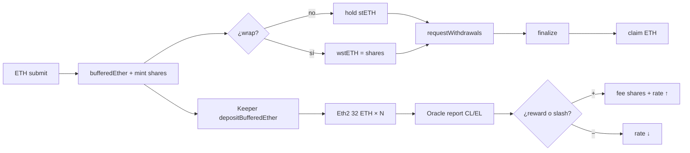

# Decisiones técnicas, lógica y gas — Módulo 18

**Idioma:** Español · [English](./decisiones-tecnicas-y-logica-EN.md)

Guía para entender **qué se construyó**, **por qué** se eligió así, **cómo fluye** el protocolo y **dónde se puede ahorrar gas** más adelante.

**Estado:** v1 cerrado · `forge test` → 90 PASS · Sync: 2026-09-15  
**Relacionados:** [GAS-ES.md](./GAS-ES.md) · [flujograma-ES.md](./flujograma-ES.md) · [diagrama-de-flujo-ES.md](./diagrama-de-flujo-ES.md) · [SWC-AUDIT-ES.md](./SWC-AUDIT-ES.md)

---

## 1. Idea en una frase

Depositas ETH → recibes **stETH** (balance que rebasea cuando hay rewards/slash) → opcionalmente lo envuelves en **wstETH** (balance fijo, valor que crece) → un **oracle** actualiza el pooled ether → el unstake es **asíncrono** vía cola (request → finalize → claim) porque el ETH en validadores no está líquido al instante.

---

## 2. Decisiones técnicas (por qué así)

### 2.1 Pool unificado = `StETH` (no hay `LiquidStakingPool` aparte)

| Decisión | Alternativa descartada | Motivo |
|---------|------------------------|--------|
| Contabilidad + token en un solo contrato | Pool + token separados | Menos wiring, menos llamadas externas en submit/report; estilo Lido simplificado para lab |
| `pooledEther = bufferedEther + clBalance` | Solo balance del contrato | El ETH en beacon no está en el contrato; el CL lo reporta el oracle |
| Shares internas + `balanceOf` = shares × rate | ERC-20 “mint/burn ETH” literal | Rebase sin transferir a todos los holders |

**Implicación:** `ILiquidStakingPool` solo expone `handleOracleReport`; el resto vive en `IStETH` + funciones del pool en el mismo `StETH.sol`.

### 2.2 Dual-token: rebasing vs value-accruing

| Token | Qué guarda el usuario | Qué cambia con rewards |
|-------|----------------------|------------------------|
| **stETH** | Shares; `balanceOf` = ETH subyacente | Sube/baja el **balance** (rate cambia) |
| **wstETH** | 1 wstETH = **1 share** | El balance ERC-20 **no** cambia; sube `stEthPerToken()` |

**Decisión:** wrapper = shares (no “wstETH amount = stETH amount”). Así wrap/unwrap es biyectivo con `getSharesByPooledEth` / `getPooledEthByShares`.

**Por qué existe wstETH:** muchos protocolos DeFi no manejan bien tokens rebasing (approvals, oráculos, accounting).

### 2.3 Precisión WAD / RAY + OZ `mulDiv`

- Conversiones shares ↔ ETH: floor division via `ShareMath` → OpenZeppelin `Math.mulDiv` (producto intermedio 512-bit).
- `shareRateRay = pooled * 1e27 / shares` para rate en RAY.
- Bootstrap vacío: **1 wei ETH ↔ 1 share** (sin dead shares / offset en v1).

**Tradeoff:** flooring deja dust; documentado como riesgo informativo SWC, no soft-lock (cubierto por fuzz).

### 2.4 Oracle: membership on-chain (sin EIP-712 en v1)

```
Miembro comité → AccountingOracle.submitReport(cl, el)
                 → chequea members[msg.sender] + reportInterval
                 → StETH.handleOracleReport (solo si msg.sender == oracle)
```

| Decisión | Motivo |
|---------|--------|
| Auth por `mapping members` | Simple, testeable, cumple `UnauthorizedOracle()` |
| Sin quorum / firmas agregadas | Fuera de alcance v1 (lab) |
| EL rewards deben estar ya en el contrato | Evita “inventar” ETH en buffer sin balance real → `InvalidReport` |
| Fee solo en rebase **positivo** | En slash no se mint fees; el rate baja para todos |

**Negative rebase:** se permite bajar `clBalance`; se **bloquea** el caso insolvente `pooled == 0 && shares > 0` → `NegativeRebaseBlocked`.

### 2.5 Fees inmutables en `FeeDistributor`

- Cap absoluto: `MAX_PROTOCOL_FEE_BPS = 1000` (10%).
- `protocolFeeBps`, `treasury`, `nodeOperators`, `treasuryShareBps` son **immutable**.
- En rebase +: se mintan **shares** de fee (diluyen levemente el rate a favor de treasury/ops).

**Por qué shares y no ETH:** no hace falta sacar liquidez del buffer; el fee es ownership del pool.

### 2.6 Depósitos Eth2: buffer → CL provisional

`depositBufferedEther(maxDeposits)` (permissionless keeper):

1. Toma N × 32 ETH del buffer.
2. Pide keys a `NodeOperatorsRegistry`.
3. **Efectos primero:** `bufferedEther -=`, `clBalance +=` (pooled total **no cambia**).
4. Loop `depositContract.deposit{value: 32 ether}(...)`.

**Decisión lab:** `depositDataRoot = keccak256(...)` de conveniencia + `MockDepositContract`. En mainnet haría falta el root SSZ canónico Eth2.

### 2.7 Withdrawal queue por `requestId` (no NFT)

Ciclo:

1. **request:** `transferFrom` stETH → queue (lock shares).
2. **finalize:** `owner` o `finalizer` (en deploy = oracle) calcula ETH claimable, marca finalized, llama `StETH.finalizeWithdrawals` (burn shares + envía ETH al queue).
3. **claim:** solo owner, CEI (`isClaimed = true` antes del `.call{value}`).

**Por qué asíncrono:** el ETH staked en validadores no está en el buffer; finalize exige liquidez en buffer (ops / EL returns).

### 2.8 Seguridad transversal

| Regla | Dónde |
|-------|--------|
| Pragma fijo `0.8.24` | Todo `src/` |
| Custom errors | `LiquidStakingErrors` |
| CEI + `.call{value}` | claim / finalizeWithdrawals |
| `ReentrancyGuardTransient` | StETH, WstETH, Queue |
| `Ownable2Step` | Admin de wiring |
| Access cruzado | `OnlyPool`, `OnlyWithdrawalQueue` |

`Paused` está definido pero **no cableado** en v1 (reservado).

---

## 3. Lógica que sigue el protocolo

### 3.1 Contabilidad central

```
totalPooledEther = bufferedEther + clBalance
shareRate        = totalPooledEther / totalShares   (si shares > 0)
stETH.balanceOf(user) = sharesOf(user) * shareRate
```

Cualquier acción que mueva ETH “económico” o shares recalcula el rate implícitamente (no hay loop sobre holders).

### 3.2 Flujo stake → accrue → unstake



### 3.3 Qué hace cada path (resumen)

| Acción | Entrada | Estado que cambia | Salida |
|--------|---------|-------------------|--------|
| `submit` | ETH | `bufferedEther↑`, shares↑ | stETH rebasing |
| `wrap` | stETH | stETH en WstETH; mint wstETH | wstETH fijo |
| `unwrap` | wstETH | burn wstETH; transfer stETH | stETH |
| `depositBufferedEther` | — | buffer→clBalance; call deposit | Validadores en cola Eth2 |
| `submitReport` | CL + EL | buffer+EL, `clBalance=CL`, fee shares si + | Rebase |
| `requestWithdrawals` | stETH | shares locked en queue | `requestId`s |
| `finalize` | ids | burn shares; ETH a queue | Requests finalized |
| `claimWithdrawal` | id | claim flag; ETH out | ETH al owner |

### 3.4 Invariantes que el diseño protege

1. **Solvencia contable:** no dejar `shares > 0` con `pooled == 0`.
2. **Oracle gated:** solo el contrato `oracle` escribe el report en el pool.
3. **Fee capped:** imposible desplegar distributor con fee > 10%.
4. **Claim seguro:** CEI + owner + finalized + no double-claim.
5. **Pooled estable en deposit:** mover buffer→CL no diluye ni enriquece stakers.

Tests: unitarios + `SlashingResilience` (fuzz) + `PoolSolvency` (invariantes).

---

## 4. Gas: qué ya está optimizado

Baseline (ver [GAS-ES.md](./GAS-ES.md)):

| Path | Gas aprox. |
|------|------------|
| submit | ~41.7k |
| wrap | ~111.5k |
| unwrap | ~112.1k |
| oracle rebase + | ~152k |
| withdrawal lifecycle | ~222k |
| deposit 1 validador | ~493k |

Ya aplicado:

- Transient reentrancy (`tstore`) vs SSTORE del guard clásico.
- Fees/recipients **immutable**.
- Custom errors.
- `mulDiv` OZ (seguridad + no reinventar FullMath).
- `maxDeposits` para acotar el loop del keeper.
- `optimizer_runs = 10_000` + `via_ir = true`.

---

## 5. ¿Se puede mejorar el gas? Sí — ideas post-v1

Ordenadas por impacto estimado vs complejidad. Ninguna es obligatoria para el lab; son mejoras reales si se lleva a producción.

### 5.1 Alto impacto / coste medio

| Mejora | Dónde | Idea | Riesgo |
|--------|-------|------|--------|
| **Packing de storage en `StETH`** | `bufferedEther`, `clBalance`, timestamps, flags | Caber más en menos slots (cold SLOAD ~2.1k) | Layout breaking; hay que re-auditar |
| **Cache immutables del wiring** | `oracle`, `depositContract`, `withdrawalQueue`, `operatorsRegistry` | Tras deploy “freeze”, pasar a `immutable` o slot packed | Menos flexibilidad admin |
| **Evitar `_slice` + `abi.encodePacked` en loop de deposit** | `depositBufferedEther` | Pasar calldata pre-sliceada o keys ya en memoria fija; reducir copies | API registry más rígida |
| **Batch finalize sin N SSTOREs innecesarios** | `WithdrawalQueue.finalize` | Acumular y escribir status en layout más denso; limitar batch size explícito | Complejidad CEI |

El path **deposit 1 validador (~493k)** es el más caro: casi todo es el call externo al deposit contract + copies de pubkey/signature. Optimizar el *loop local* ayuda poco frente al coste externo; batching N en una tx reparte overhead fijo.

### 5.2 Medio impacto / bajo coste

| Mejora | Idea |
|--------|------|
| **Wrap sin approve** | Preferir `receive()` ETH→submit→mint (ya existe) en UX; documentar como path barato |
| **`transferShares` en request** | Lockear shares directo sin pasar por amount→shares en allowance ETH-denomination |
| **Unchecked en contadores** | Ya hay `unchecked { ++i }` en loops; extender donde la cota es obvia |
| **Custom errors ya OK** | No volver a `require` strings |
| **Events indexados selectivos** | Revisar topics vs data según indexers (ahorro menor) |

### 5.3 Bajo impacto / cuidado semántico

| Mejora | Nota |
|--------|------|
| Quitar transient guard en views | No aplica; guards solo en state-changing |
| Assembly Yul para `.call` | Ahorro pequeño vs legibilidad; OZ-style `.call` ya es aceptable |
| `via_ir = false` | Aquí `true` ayuda; no cambiar sin medir |
| Dead shares / virtual offset | Puede mejorar dust attacks; **cuesta** gas/math; no está en v1 |

### 5.4 Lo que **no** conviene “optimizar”

- Quitar CEI o el chequeo de `ok` en `.call{value}` → ahorro ínfimo, riesgo alto (SWC-104/107).
- Inventar ETH en oracle sin balance → rompe solvencia.
- Metafactory / proxy solo por gas → complejidad de upgrade fuera de v1.
- NFT withdrawal tickets → más caro que `requestId`, no más barato.

### 5.5 Cómo medir cualquier mejora

```bash
export PATH="$HOME/.foundry/bin:$PATH"
forge test --match-contract LiquidStakingGasTest --gas-report
forge snapshot --match-contract LiquidStakingGasTest
# comparar contra .gas-snapshot
```

Regla: **una mejora = un delta medido** en el path concreto (submit / wrap / deposit / oracle / withdraw).

---

## 6. Mapa mental de archivos

| Quieres entender… | Lee |
|-------------------|-----|
| Por qué / fases | [planificacion-ES.md](./planificacion-ES.md) |
| Quién llama a quién | [diagrama-de-clases-ES.md](./diagrama-de-clases-ES.md) |
| If/else por función | [diagrama-de-flujo-ES.md](./diagrama-de-flujo-ES.md) |
| Ciclo e2e | [flujograma-ES.md](./flujograma-ES.md) |
| Baseline gas | [GAS-ES.md](./GAS-ES.md) |
| Riesgos SWC | [SWC-AUDIT-ES.md](./SWC-AUDIT-ES.md) |
| Código pool | `src/StETH.sol` |
| Código wrapper | `src/WstETH.sol` |
| Código cola | `src/WithdrawalQueue.sol` |

---

## 7. Resumen ejecutivo

1. **Decisiones:** pool=`StETH`, dual-token shares/wrapper, oracle por membership, fees immutables, cola request-id, deposit Eth2 con buffer→CL estable, math WAD/RAY + mulDiv, seguridad CEI/transient/custom errors.
2. **Lógica:** ETH entra al buffer → opcional wrap → keeper deposita 32 ETH → oracle rebasea → unstake asíncrono cuando hay liquidez.
3. **Gas:** v1 ya está en un buen baseline lab; el mayor margen real está en **storage packing / immutables de wiring**, **menos copies en deposit**, y **UX wrap vía `receive()`**; el deposit Eth2 seguirá dominado por el call externo.
