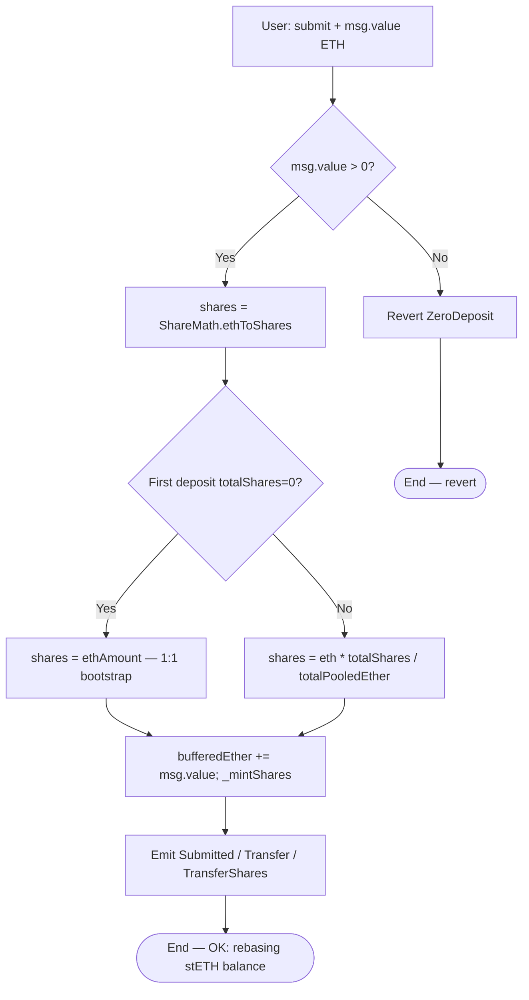
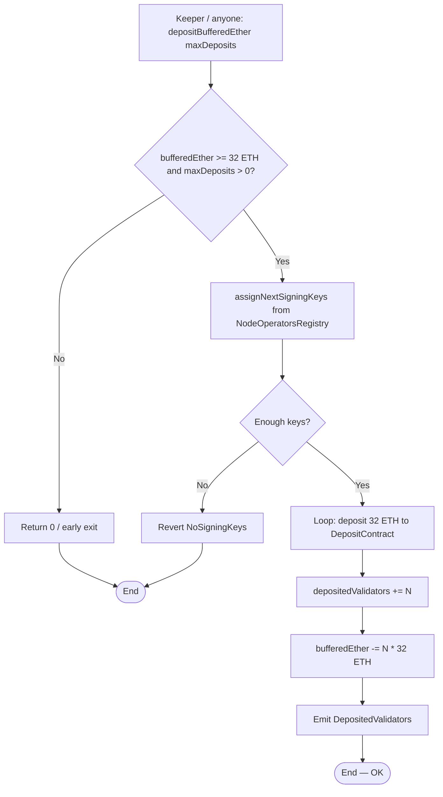
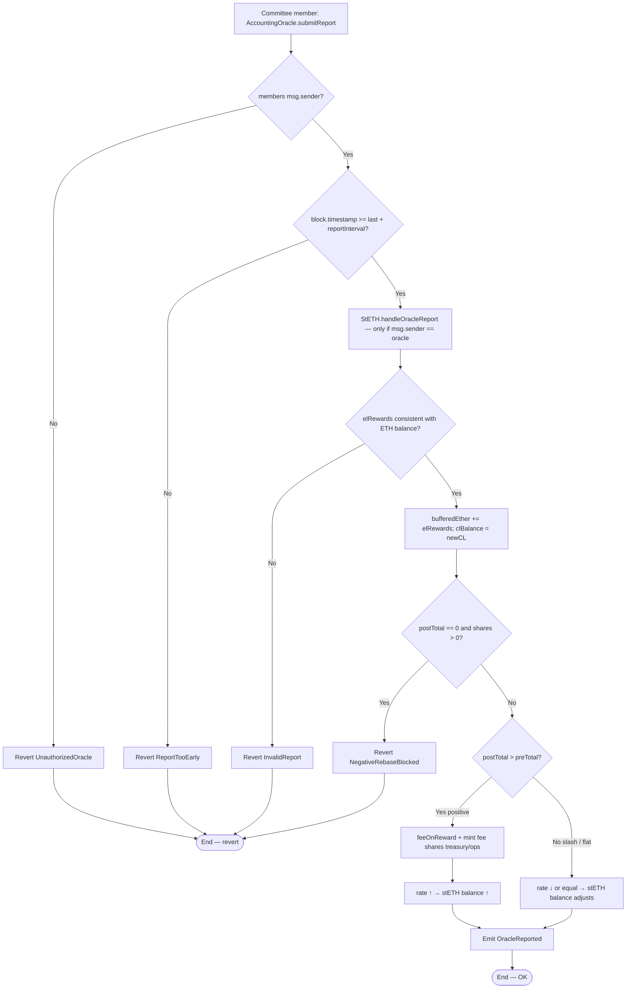
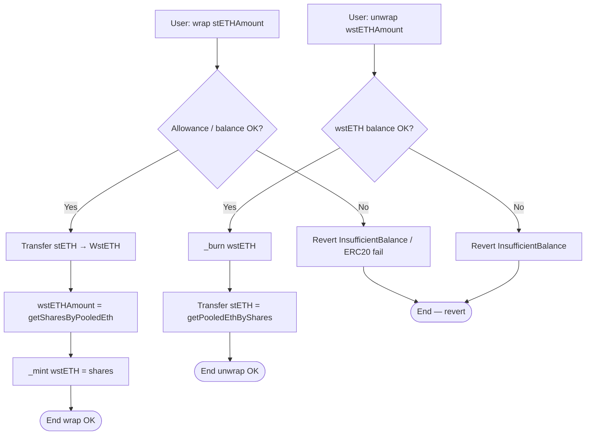
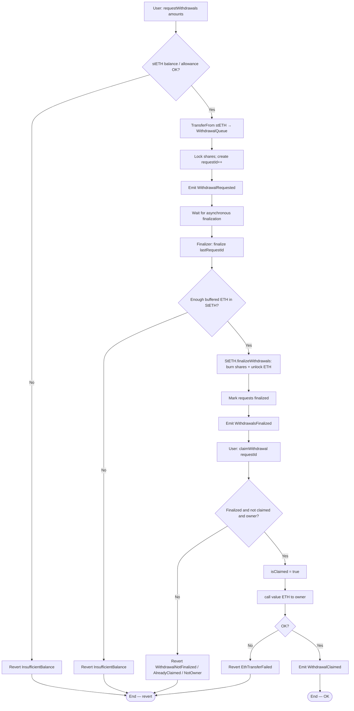
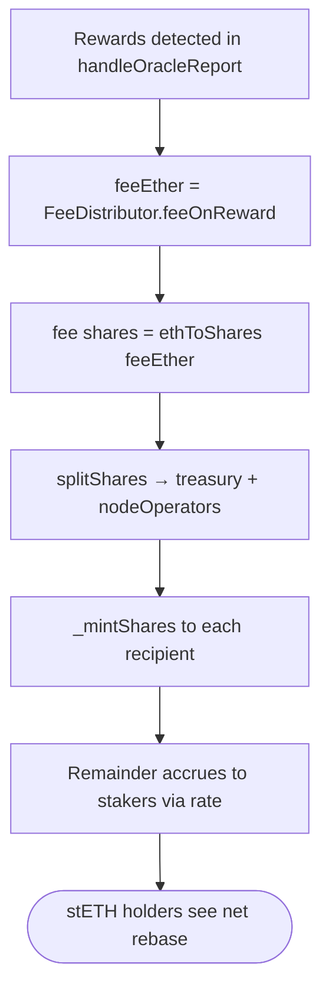

# Flow diagram — Deposit, oracle rebase, and withdrawal queue

**Language:** English · [Español](./diagrama-de-flujo-ES.md)

Internal decision flows of the protocol (module 18, **v1 implemented**).  
**Sync:** 2026-09-14 · Phases **0–7** ✅ · 90 PASS.

## 1. submit (ETH → shares / stETH)

> CEI: update buffer and shares **before** any external call. ETH stays in the internal buffer (no outbound transfer in submit).  
> `Paused` exists in `LiquidStakingErrors` but is **not** wired in v1.

---

## 2. depositBufferedEther → Eth2 Deposit Contract

---

## 3. Oracle report — positive / negative rebase

> v1 auth: **on-chain membership** (`msg.sender ∈ members`), no EIP-712 signatures nor multi-sig quorum.  
> `balanceOf(stETH)` adjusts without transfers (fixed shares, variable rate).  
> `wstETH.balanceOf` does **not** change; `stEthPerToken()` does.

---

## 4. Wrap / unwrap wstETH

> 1 wstETH = 1 share. `receive()` on WstETH: ETH → `stETH.submit` → wrap.

---

## 5. Withdrawal queue — request → finalize → claim

> CEI in claim: set `isClaimed` **before** `.call{value: ...}("")`.  
> `finalize`: `owner` **or** `finalizer` (deploy sets `finalizer = oracle`). The queue then calls `StETH.finalizeWithdrawals` (`OnlyWithdrawalQueue`).

---

## 6. Fee split on rewards

> Cap validated in the `FeeDistributor` **constructor** (`FeeCapExceeded` if `protocolFeeBps > 1000`).
