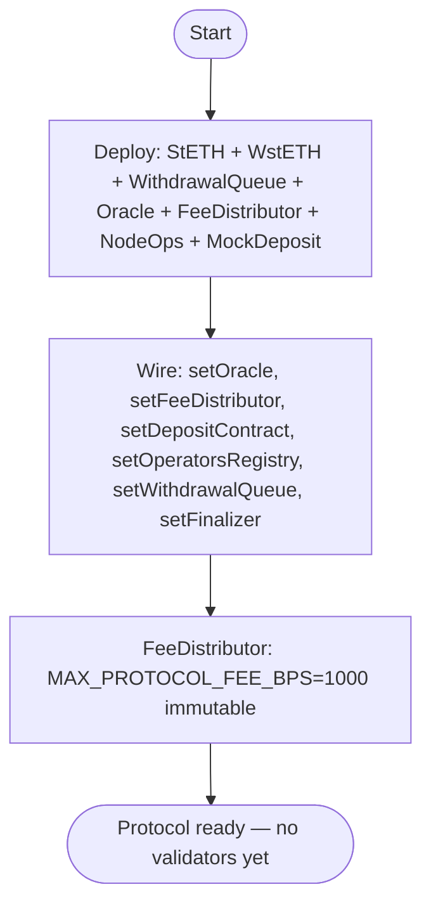
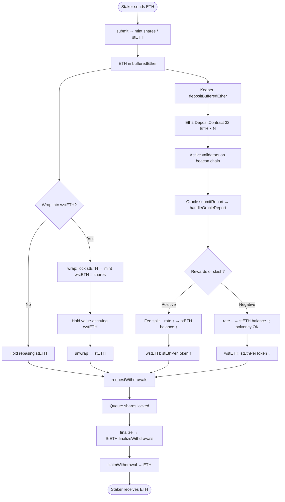
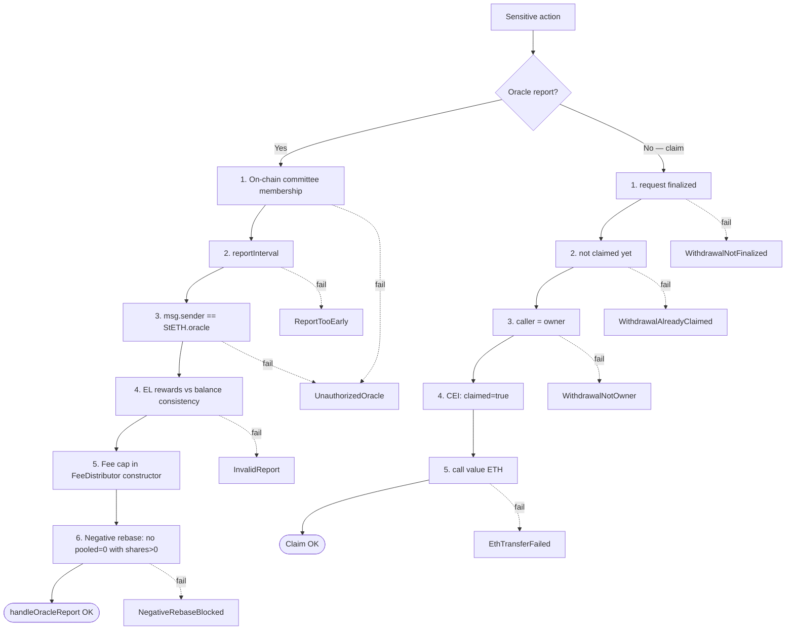
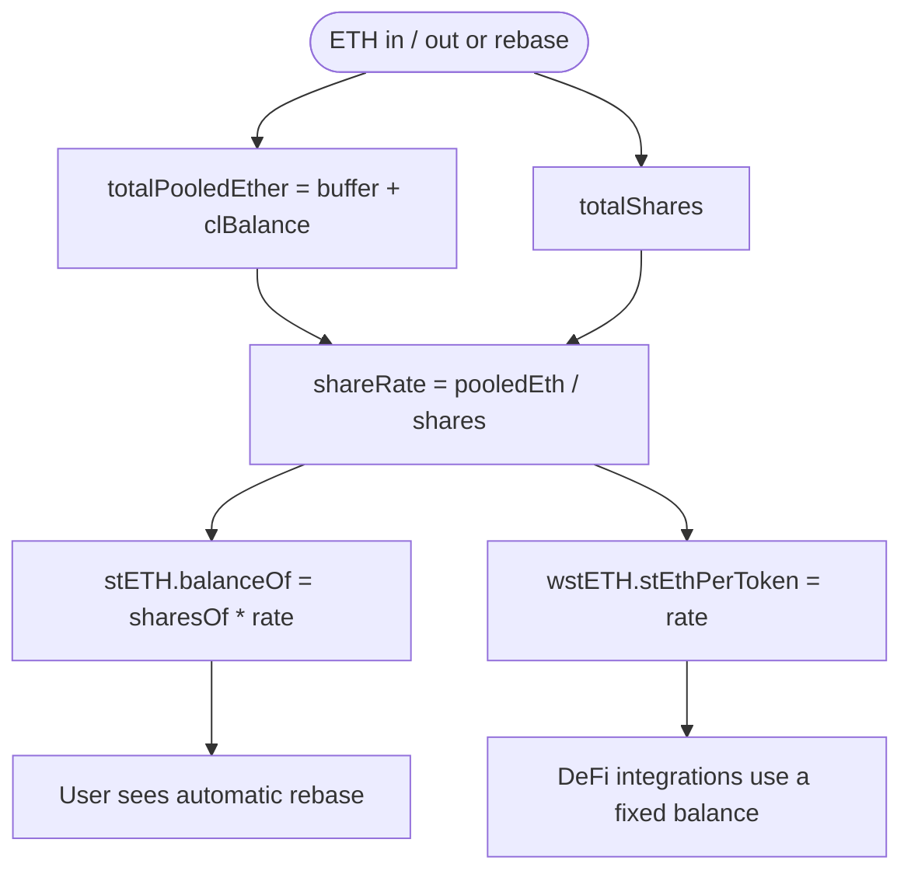
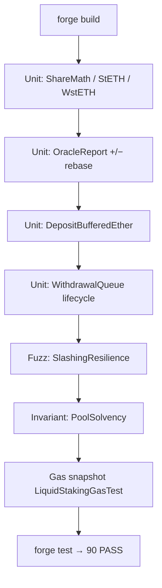

# Flowchart — Full Liquid Staking Protocol cycle

**Language:** English · [Español](./flujograma-ES.md)

End-to-end flow between stakers, pool, oracle, deposit contract, and withdrawal queue (module 18, **v1 implemented**).  
**Sync:** 2026-09-14 · Phases **0–7** ✅ · 90 PASS.

## Actors

| Actor | Role |
|-------|------|
| Staker | Deposits ETH (`submit`); optionally wraps into `wstETH`; requests unstake |
| Node Operator | Provides signing keys; receives a share of reward fees |
| Oracle Committee | On-chain members call `submitReport` (CL + EL); triggers rebase |
| StETH (pool) | Shares accounting, buffer, CL, deposits, finalizeWithdrawals |
| WstETH | Non-rebasing wrapper for DeFi / composability |
| WithdrawalQueue | Asynchronous queue request → finalize → claim |
| Eth2 Deposit Contract | Receives 32 ETH deposits per validator (mock in lab) |
| FeeDistributor / Treasury | Fee split with immutable 10% cap |
| Keeper | Calls `depositBufferedEther` when buffer ≥ 32 ETH |
| CI / Foundry | Unit, +/− rebase fuzz, withdrawal lifecycle, invariants, gas |

---

## Flowchart — Deploy

> Lab deploy: `queue.setFinalizer(address(oracle))`. Either `owner` or `finalizer` can finalize.

---

## Main flowchart — Stake → Accrue → Unstake

---

## Flowchart — Defense layers (oracle + withdraw)

---

## Flowchart — Shares accounting (WAD / RAY)

---

## Flowchart — Foundry tooling (lab)

---

## Related docs

| Document | Content |
|----------|---------|
| [diagrama-de-clases-EN.md](./diagrama-de-clases-EN.md) | Contracts, interfaces, libraries (implementation) |
| [diagrama-de-flujo-EN.md](./diagrama-de-flujo-EN.md) | Internal per-function decisions |
| [planificacion-EN.md](./planificacion-EN.md) | Phases 0–7 closed, v1 architecture |
| [SWC-AUDIT-EN.md](./SWC-AUDIT-EN.md) | SWC matrix |
| [GAS-EN.md](./GAS-EN.md) | Gas baseline |
